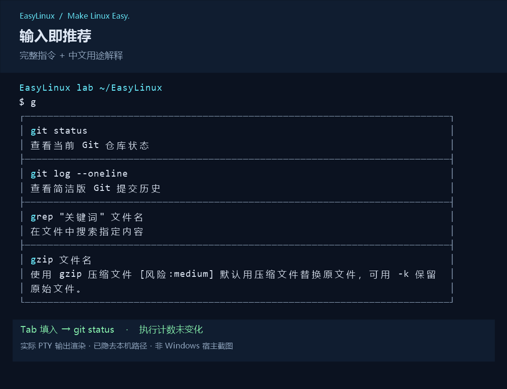
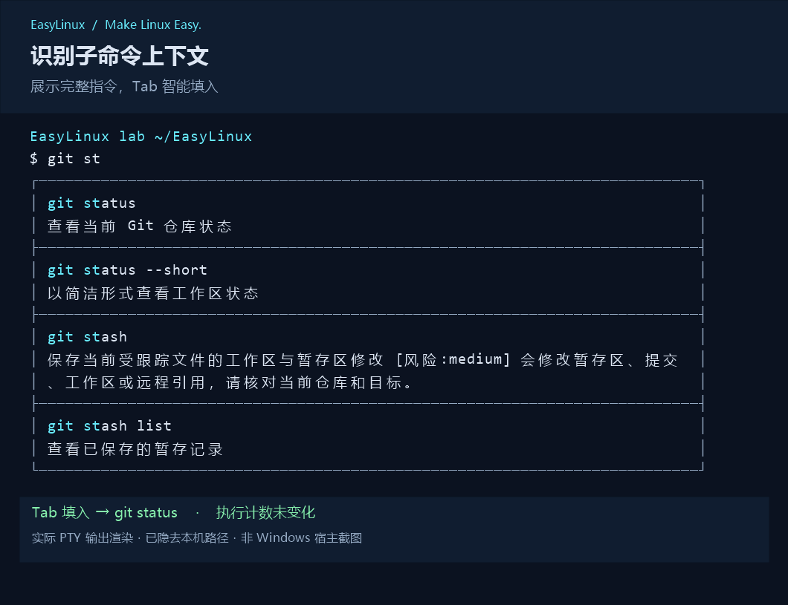
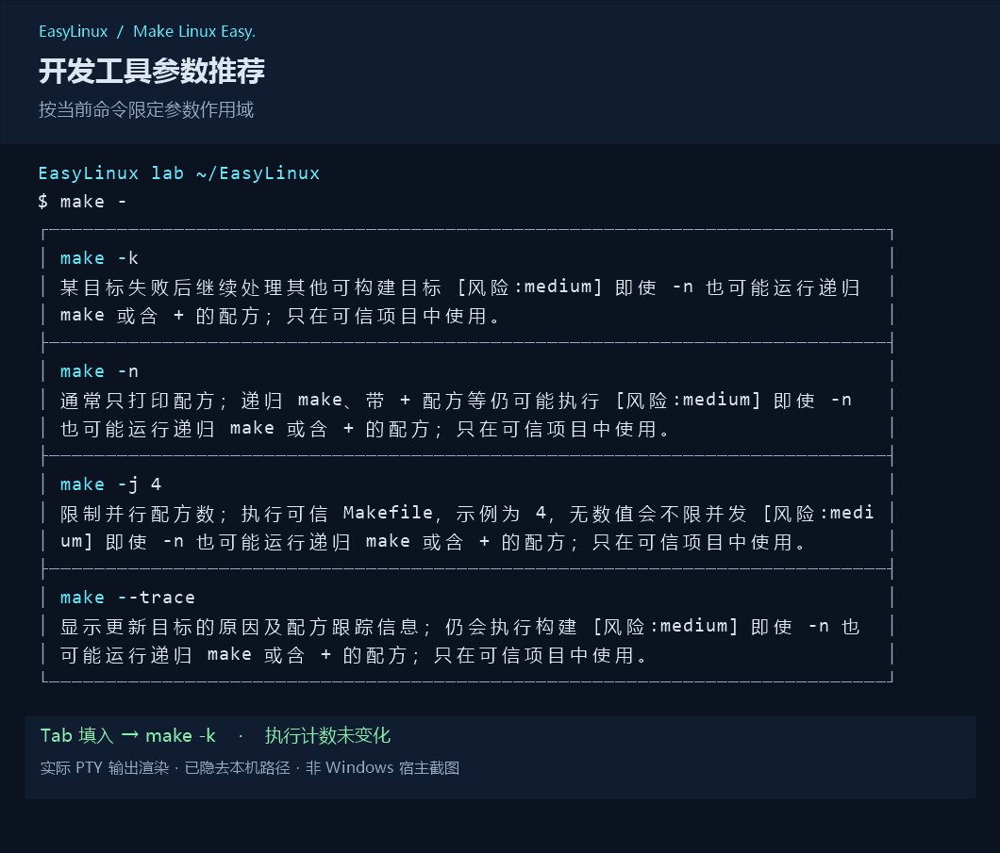

# EasyLinux

**Make Linux Easy.**

面向 Linux Bash 的中文命令学习辅助工具。输入时推荐完整命令和中文解释，使用上下键选择、Tab 增量填入、Esc 关闭。选择候选不会自动执行；Enter 保留 Bash 正常执行行为。

当前为测试版本，包含 159 条指令知识、13 个分类以及独立参数库。覆盖文件管理、文本、网络、Git、Docker、Make、GCC/G++、CMake、Ninja 和 Shell 脚本等场景。

## 演示

以下图片根据当前版本真实 PTY 会话输出渲染，已将本机路径替换为 `~/EasyLinux`。它们不是 Windows 宿主截图，不代表完成新的真实窗口缩放验收。每组都实际验证了 Tab 填入结果，执行计数保持不变。

### 输入即推荐

输入 `g`，显示完整候选指令、中文用途及必要的风险提示，最多 4 条。



### 子命令与增量填入

输入 `git st`，匹配 Git 子命令。Tab 填入后为 `git status`，不会重复已有前缀，也不会自动执行。



### 开发工具参数

输入 `make -`，显示 Make 参数的中文含义和执行风险。参数候选依照当前命令作用域生成。



## 启动

需要 Linux（原生或 WSL）、Bash 5+、Python 3.10+、UTF-8 交互式终端，以及常见 Linux 基础工具。无需 pip 包。固定版本 ble.sh 已随仓库提供，启动时不下载或安装软件。

```bash
git clone https://github.com/rice777betrue-spec/EasyLinux.git
cd EasyLinux
bash start.sh
```

Windows 用户先运行 `wsl.exe`，然后在 Linux 中执行上面的命令。建议将项目放在 Linux 用户主目录。原生 PowerShell 不能直接加载 Bash 插件。

启动独立 Bash 会话，不修改用户 `~/.bashrc` 或全局配置。运行数据、历史与诊断写入本项目的 `runtime/` 和 `logs/`；这两个目录被 Git 忽略。退出使用 Ctrl-C 清空输入后，在空行按 Ctrl-D。

## 使用与测试

尝试输入 `g`、`git st`、`docker`、`make -j`、`gcc -`、`cmake --build`、`bash -n` 或 `shellcheck`。最多显示 4 条候选，展示完整命令并突出匹配前缀。

- 上下键：选择候选。
- Tab：填入候选，保持当前命令行编辑，不自动执行。
- Esc：关闭候选。
- Enter：执行当前命令，请谨慎使用。

知识库不等同于本机已安装工具清单。示例中的文件名、服务名、构建目录和 Makefile 目标需要根据实际项目调整。`make clean` 仅在项目定义该目标时有效；Make、CMake、Ninja 和 `bash -x` 等可能执行项目或脚本代码，请阅读风险提示。

可选 PTY 冒烟测试（不会发送 Enter 执行推荐）：

```bash
chmod u+x scripts/start-test
python3 -B tests/smoke.py
```

测试结果位于 `logs/smoke/`。自动化测试不能代替实际 Windows ConHost、SSH 和其他终端的人工验收。建议测试横向极窄恢复三次、高度缩小恢复、中文、光标中间编辑和各快捷键。

## 目录

- `core/`：独立 Python 推荐、排序和上下文处理。
- `data/commands.json`、`data/options.json`：中文指令与参数知识。
- `adapters/bash/`：Bash 与 ble.sh 交互适配。
- `config/`：独立会话配置与颜色兼容设置。
- `vendor/blesh/`：固定版本 ble.sh 及其许可证。
- `tests/`：可移植 PTY 冒烟测试。

## 当前限制

部分中间光标位置会保守隐藏候选；紧邻管道的参数补全可能改变空格位置。CMake 构建参数上下文当前围绕示例目录 `build`，不自动发现任意目录、源文件或 Makefile 目标。学习统计尚未实现。

传统 Windows ConHost 的语法错误样式采用仅红字，保留提示并避免红底和下划线。此前用户已确认该设置正常，但其他宿主与环境仍需独立验收。

本次公开副本包含与正式版本一致的 Core、适配层和知识库，启动路径改为项目相对定位。未携带原作者的会话历史、诊断、缓存、截图或整个开发工作区。反馈日志前请检查并移除私人路径、输入和敏感内容。

## 第三方与许可

ble.sh 固定提交：`152942758f567e51fd17bdc7b3783d27b3c476aa`，源自 https://github.com/akinomyoga/ble.sh 。原许可证保存在 `vendor/blesh/licenses/`，第三方源码未修改。

EasyLinux 暂未指定项目级开源许可证。仓库公开可见不代表授予第三方依赖许可证之外的额外使用许可；本次发布不替作者选择许可证。
